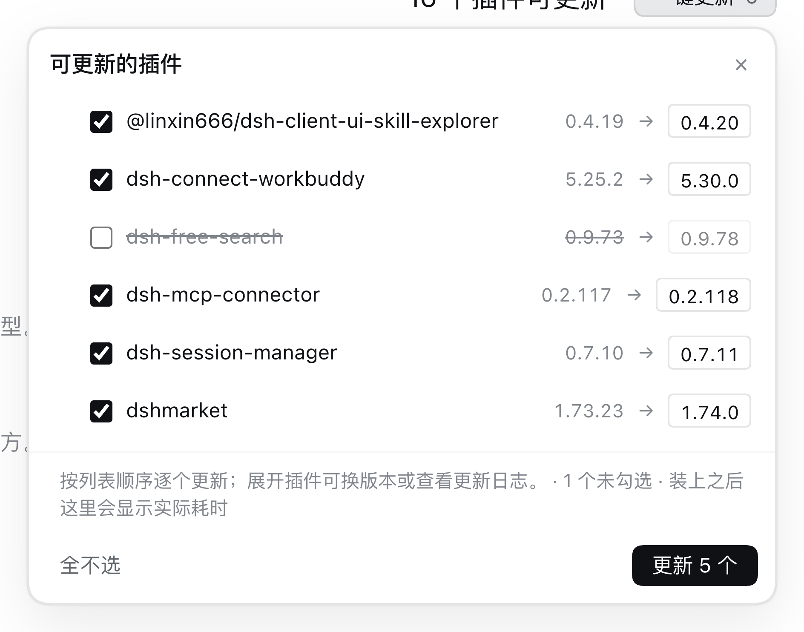
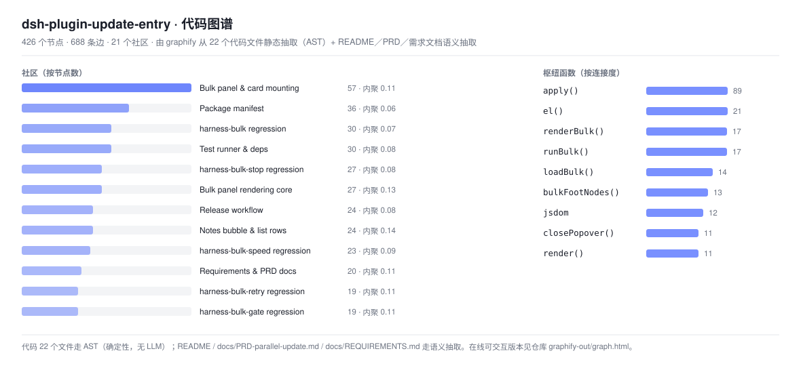

# 插件更新入口 · dsh-plugin-update-entry

一个 DeepSeek Harness 插件：把「更新」放回你每天真正会点的地方——插件卡片上、开关之前；多个包要更新时，在工具栏的同一个面板里勾选、批量更新，并且看得见每一项装到哪一步、花了多久。


单个插件时入口就在卡片上（下图）；一次要更新好几个时，工具栏上是同一套东西的整批形态：


> **English.** A DSH plugin that puts an update control immediately before each plugin card's
> switch, with a version picker that mirrors the detail page and per-version release notes on
> hover. A toolbar panel updates a chosen subset of plugins in one run, ticking each row with the
> time it took. Same data and same Host operation as the official page — just where the hand
> already is.

---

## 它解决什么

官方插件页把更新动作放在**详情页**里：列表上的卡片只有一个「可更新」徽标，想知道有什么新版本、要更新到哪个版本，得先进详情页、再点一次。每天扫一眼「有没有可更新的」这件事，被拆成了三步。

这个插件把那一步补回列表：卡片右侧、开关之前多一个「更新」。点开就是版本列表，选一个就地更新，进度和结局都在原地显示。

它**不改动**官方页面的任何逻辑，也不接管更新流程——调用的仍是 Host 自己的 `pluginManager/updateBundle`，所以检查、移除、安装、失败回滚全部沿用官方实现。

## 六个能力

### 1 · 更新入口在开关之前


只有带「可更新」徽标的卡片才会出现入口，其余卡片保持原样。入口高度与开关齐平（22px），行高不变，列表不会因此跳动。

### 2 · 版本选择，和详情页同一套数据

- 只列**比已安装版本新**的版本，新的在前；数量上限跟随 Host 的 `versionListLimit`。
- 每个版本标注：发布日期、`预发布`、`已弃用`、`需要 <peers>`（新版本要求更高的 DSH）、`这个版本没有声明组合包`。
- 不可安装的行会变灰并说明原因；默认选中第一个可安装版本。
- 页脚显示安装源与「另有 N 个版本未列出」，也可切换显示预发布版本。

浮层贴着开关所在的列右对齐；下方空间不足时自动翻到卡片上方。列表是 `role="listbox"`，支持 `↑` `↓` `Home` `End`，`Esc` 逐层关闭。

### 3 · 悬停看这个版本改了什么

指针停在某个版本行上约 140ms，左侧弹出该版本的更新说明；移到气泡里不会消失，移开约 180ms 后消失。说明来自该包的 **GitHub Releases**，按 tag 里的语义化版本匹配。

读不到 Release 时降级为版本元数据（版本、发布日期、标签、是否组合包、所需 DSH），不编造内容。

### 4 · 一键更新：工具栏上的整批入口


官方在工具栏显示「N 个插件可更新」时，紧挨着它会出现「一键更新」。点开是一份**全部可更新插件**的清单（数据来自 `pluginManager/listBundles`，与官方刷新同源），每个插件一行：

- 左边是包名与已安装版本，右边是本次要更新的目标版本；中间有 `→` 表示目标高于当前版本。
- 展开任意一行可以换版本——规则与单个插件完全相同：只列更新的版本，不可安装的行变灰说明原因，默认选中第一个可安装版本。
- 版本行同样支持悬停看该版本在 GitHub 上的更新说明，读不到时降级为版本元数据。
- 注册表没有返回任何更新的包（`listBundles` 把它算作可更新，只是因为它*可能*被更新）**不占一行**——否则一份「已是最新版本」的列表会盖住真正有更新的包。空列表也不会写进缓存，下次打开会重新问。
- 新版本存在但在这台机器上装不了的包（例如要求更高的 DSH）仍然留在列表里，行下标出「没有可直接安装的新版本」，一键更新时自动跳过，不会静默失败。
- 版本读取失败或还没回来的行显示「重试」而不是「正在检查更新」，并且**不会让底部按钮失效**——点「更新 N 个」时会先补读这些行，读完仍拿不到才跳过。这条是必须的：把「没读到」当成「没有更新」正是真实的更新看起来"没被检测到"的原因。

点「更新 N 个」后**按列表顺序逐个更新**，一次只有一个插件在动，面板里逐行显示进度与结果，底部汇总「x 个已更新，y 个失败 · z 个已跳过」。被跳过的行会在汇总里点名，不会凭空消失。

面板跟随工具栏按钮定位：右对齐、超出视口时贴边、下方空间不足翻到上方；运行中点击面板外部不会关闭面板，避免唯一的进度视图消失。

### 5 · 部分更新：只勾你要的那几个



- 每行最左边有一个勾选框，默认全勾：只更新你要的那几个包。取消勾选的行不参与本次更新，行内会划掉并标「未勾选，已跳过」，底部按钮的数字随之变化；「全选 / 全不选」一个点击就能清空或恢复。
- 页脚实时给出「N 个未勾选 · 更新 M 个」，M 是本次真正会被更新的数量；全部取消勾选时按钮变灰。
- 未勾选的行在结果面板里标「未勾选，已跳过」，汇总里单独计数，不会被算成失败。

### 6 · 慢要看得见：计时、停止、预期时长

安装阶段的慢是宿主的：每次更新都在 `profile/package.json` 的写锁里跑一遍 pnpm 全量重解析，实测一次 3–6 分钟，而且抢锁超过两分钟就报 `atomic-write: timed out waiting for the writer lock`。所以这里做了三件事：

- **能并行的先并行**：开跑前对「版本还没读到」的行做 4 路并发补读，而不是一个一个往返；安装本身仍然严格串行（并发只会排队在锁上，然后超时失败，还让「停止」失效）。
- **慢要看得见**：正在装的那一行和页脚都逐秒计时，超过 90 秒追加「宿主正在安装，网络慢时会更久」；跑完每行保留实际耗时，不足 1 秒不显示（`0s` 看起来像没装）。
- **耗时变成预期**：页脚用已跑完的样本中位数估「约 N × 32s」，第一次运行之前说明「装上之后这里会显示实际耗时」。
- **抢锁超时不算失败**：这类错误说明请求根本没进 pnpm，面板提示「上一次更新仍在进行，请稍后重试」，并在队列排空后自动重试一次，而不是把包标成更新失败。

运行中可以「停止」。已经发给 Host 的那一次安装无法撤回——它持有 `package.json` 的独占锁，必须跑完——所以停止的真实含义是「这一个装完就不再开始下一个」。界面按这个事实说：点下停止后按钮变灰并显示「正在停止」，进度文案变成「正在停止，等 <包名> 装完就停」，不再是一个点了没有任何变化的死按钮。

一次运行结束后再点工具栏上的「一键更新」是**重新检测**，不需要先点一次关掉结果面板：面板直接回到读取状态并重新取版本；结果面板里也有「重新读取」，只刷新列表、不动任何包。

### 更新过程

选中版本后是就地确认，不弹官方 Modal：

```
将从 0.9.37 更新到 0.9.43，期间插件可能短暂停止。
安装失败时会保留或重新安装 0.9.37。
```

确认后按钮进入进行态，步骤文字跟随 Host 的 `plugin-manager/update-state` 事件（检查 → 停止并移除 → 安装 → 重新安装）。结局沿用官方判定：已更新 / 已安装，重启后生效 / 无法更新 / 无法移除 / 已恢复到旧版本 / 更新失败且插件未安装 / 无法确认结果。失败时展开「查看安装输出」可看到安装器原始日志。

## 安装

在插件页点「添加插件」，填入包名或仓库地址：

```
dsh-plugin-update-entry
```

也可以直接装 Release 里附带的 `npm pack` 产物（与 npm 上的 tarball 是同一份字节）：

```
https://github.com/createjy/dsh-plugin-update-entry/releases/download/v1.0.5/dsh-plugin-update-entry-1.0.5.tgz
```

装好后插件页会多出一行「插件更新入口」，默认启用。它自己也是一个普通组合包，可以随时关掉——关掉后注入的按钮和浮层会一并移除，页面回到原样。

**要求**：DSH 桌面端或 Web 端（Client 侧插件）。插件本身没有 Host 逻辑，不需要重启后端。

**兼容版本**：`engines.dsh = ^0.2.2-rc.1`（`>=0.2.2-rc.1 <0.3.0`，`includePrerelease`）。rc.1 / rc.3 / rc.5 都在桌面端实机跑过，rc.5 是零改动适配（它的官方客户端 bundle 与 rc.3 只差 `sourceMappingURL`）。
rc.3 起 `listBundles` 用 `update: 'registry' | 'git'` 取代 `updatable: true`，插件同时读两种形状；官方 CSS module 前缀是构建产物（rc.2 是 `X_2TxG_`，rc.5 回到 `w6M7KW_`），插件只匹配类名子串。

## 边界与取舍

| 情况 | 行为 |
| --- | --- |
| 卡片没有「可更新」徽标 | 不注入入口 |
| 官方内置组合包（`official: true`） | 不注入（Host 不允许更新它们） |
| 只有一个可更新版本 | 仍然显示版本列表，只是只有一行 |
| 包没有 GitHub 仓库 | 悬停降级为版本元数据 |
| GitHub API 限流（403/429） | 本会话不再请求该仓库，悬停直接显示元数据 |
| 网络不可用 | 版本列表显示失败原因与「重新检查」，不缓存错误 |
| 想降级 | 不支持，只处理比已安装更新的版本 |

其它已知限制：

- 更新说明只来自 GitHub Releases。仓库把说明写在 CHANGELOG 里、或 release 正文为空时，看到的是元数据而不是正文。
- 未登录的 GitHub API 每个出口 IP 每小时 60 次。正常使用（只在你悬停时请求）不会碰到，但同一出口 IP 下的其它工具会共享这个额度。
- 版本检查会为每个候选版本向 registry 查一次元数据，所以**只在点开时查询**，不做预取、不在页面加载时批量查询。结果缓存 10 分钟。

## 实现说明

### 代码长什么样



代码走静态 AST、文档走语义抽取，合成一张图；连接度最高的是 `apply()`、`el()`、`renderBulk()`。

### 为什么是 DOM 注入

官方插件页没有「列表卡片动作」插槽：`plugins.item` 只接受官方条目，`plugins.detail.actions` 只在详情页。要满足「在开关之前」这个位置要求，只能在卡片渲染完成后把按钮插进 `.cardEnd`。

这是一处**有意的例外**，边界控制得很死：

| 约束 | 做法 |
| --- | --- |
| 定位方式 | 只认稳定属性：`li[data-plugin-package]`、`[class*="cardEnd"]`、`[class*="bundleToggle"]`、徽标文本 |
| 插入位置 | `cardEnd.insertBefore(slot, cardEnd.firstElementChild)`，即官方为进度点预留的位置之前 |
| React 重渲染 | `MutationObserver` + `requestAnimationFrame` 合并扫描；`cardEnd` 被重建时自动重挂 |
| 卡片移除 | `li` 离开 DOM 即卸载，不残留监听 |
| 卸载 | 所有节点、样式、监听都有对应清理；关掉插件即回到原样 |

不读 React fiber、不改官方组件的状态、不覆盖官方样式。

### 传输层：三级降级

Client 插件调 Host 服务的常规写法是 `inject: ['remote.pluginManager']`，但那会让整个模块等命名空间挂载——没就绪时按钮根本不出现。这里改成按需解析并留了三级降级：

| 层 | 方式 |
| --- | --- |
| ① service | `ctx.get('remote.pluginManager')` |
| ② rpc | `connection.rpc.call('/api', 'pluginManager/<method>', { args })` |
| ③ fetch | `POST /api/pluginManager/<method>` |

`args` 必须是按参数名索引的普通对象（`{ name, options }`），不是数组——网关按 `descriptor.parameters` 的 wire 名组装参数。读操作任一层失败都能换下一层；写操作只在错误能证明「请求没发出去」时才重试，否则可能把一次更新下发两遍。

### 依赖与权限

- 不写 Host 代码：`index.js` 是空实现，插件只提供 Client 模块。
- 不新增依赖：没有 React、没有 UI 组件库，全部用原生 DOM 与官方主题变量。
- 不读其它插件的源码或样式表；样式只使用 `--dsw-*` 主题变量，深色/浅色跟随系统。
- 请求只有两处，都由你触发：registry 的版本元数据（经 Host 的 `listVersions`）和 GitHub Releases（悬停时）。

不收集、不上报任何使用数据。版本说明在 `sessionStorage` 里缓存 20 分钟（关掉标签页即失效），`localStorage` 只用于调试开关。

## 许可

MIT
